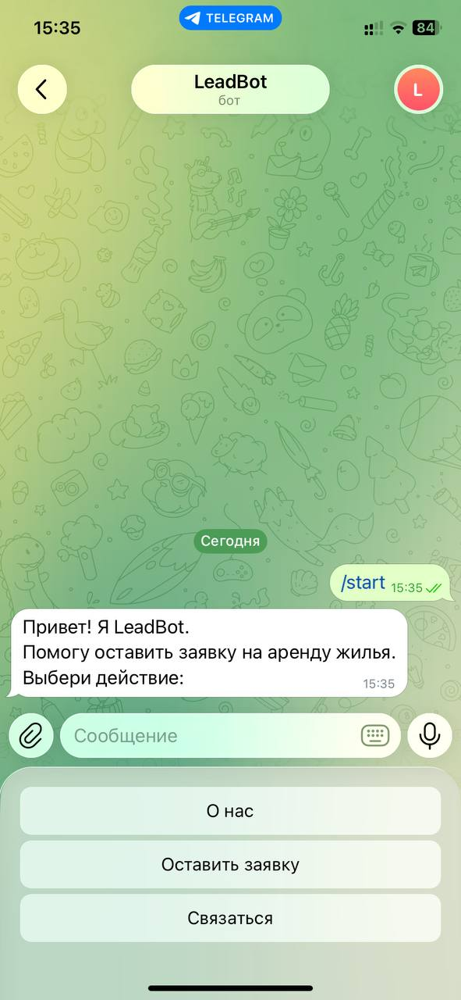
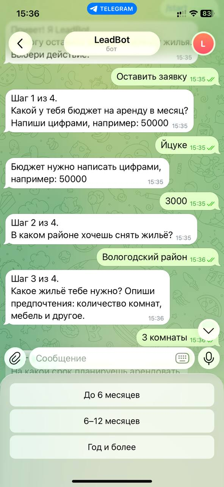
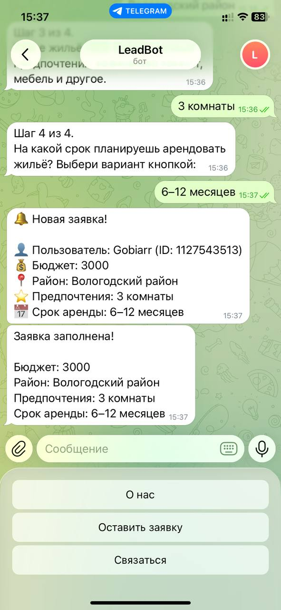

# 🤖 LeadBot — бот для сбора заявок на аренду жилья

Telegram-бот, который собирает заявки клиентов через пошаговую анкету,
сохраняет их в базу данных и мгновенно уведомляет администратора.

## 🚀 Возможности

- 📋 Пошаговая анкета из 4 вопросов (бюджет, район, предпочтения, срок аренды) на базе FSM
- 🛡 Валидация ввода: бюджет принимается только цифрами, срок аренды — кнопками
- 💾 Хранение заявок в SQLite — данные не теряются при перезапуске бота
- 🔔 Мгновенные уведомления администратору о новой заявке
- 📊 Команда `/list` — просмотр последних заявок прямо в чате (только для админа)
- ❌ Команда `/cancel` — отмена заполнения анкеты на любом шаге
- ✉️ Кнопка «Связаться» с переходом в личку администратора

## 🛠 Технологии

- **Python 3.11+**
- **aiogram 3** — работа с Telegram Bot API
- **SQLite** — база данных (стандартная библиотека Python)
- **FSM (Finite State Machine)** — пошаговый сценарий анкеты
- **python-dotenv** — хранение секретов в переменных окружения

## 📁 Структура проекта

```javascript
leadbot/
├── bot.py          # Точка входа: запуск бота
├── config.py       # Загрузка токена и ID администратора
├── states.py       # Состояния анкеты (FSM)
├── keyboards.py    # Клавиатуры: меню, кнопки срока, кнопка связи
├── handlers.py     # Обработчики команд и сообщений
├── database.py     # Инициализация SQLite, сохранение и выборка заявок
├── requirements.txt
└── .env.example    # Шаблон файла с секретами
```

## 📦 Установка и запуск

1. Клонируй репозиторий:

```bash
   git clone https://github.com/Gobiarr/leadbot.git
   cd leadbot
```

2. Создай виртуальное окружение и активируй его:

```bash
   python -m venv .venv
   .venv\Scripts\activate      # Windows
   source .venv/bin/activate     # Linux / macOS
```

3. Установи зависимости:

```bash
   pip install -r requirements.txt
```

4. Получи токен у [@BotFather](https://t.me/BotFather) и узнай свой ID у [@userinfobot](https://t.me/userinfobot).
5. Создай файл `.env` по образцу `.env.example`:

```javascript
   BOT_TOKEN=токен_от_BotFather
   ADMIN_ID=твой_id_из_userinfobot
```

6. Запусти бота:

```bash
   python bot.py
```

## 🎮 Команды

| Команда | Описание | Кому доступна |
| --- | --- | --- |
| `/start` | Главное меню | Всем |
| `/cancel` | Отмена заполнения анкеты | Всем |
| `/list` | Последние 10 заявок | Только админу |

## 📸 Screenshots

### Main menu


### Rental application


### Admin notification

